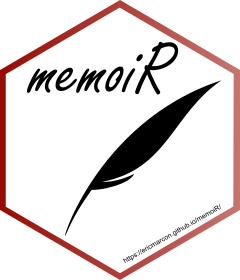

```{r}
#| label: Options
#| include: false
### Customized R options for this document
# Delete this chunk if you don't use R

# Necessary packages. Add all packages used in the code here.
packages_required <- c(
  # R tools, do not modify
  "knitr",   # to run the code chunks
  "formatR", # if tidy = TRUE below
  # Add specific packages here
  "tidyverse", 
  "gt",
  "ggplot2",
  "dplyr",
  "purrr",
  "patchwork",
  "cowplot"
)
# Already installed?
packages_installed <- vapply(
  packages_required, 
  FUN = requireNamespace, 
  FUN.VALUE = TRUE, 
  quietly = TRUE
) 
# Install missing packages
install.packages(
  names(packages_installed)[!packages_installed],
  repos = "https://cran.rstudio.com/",
  quiet = TRUE
)

# Allow size='small' or any valid Latex font size in chunk options
def.chunk.hook <- knitr::knit_hooks$get("chunk")
knitr::knit_hooks$set(
  chunk = function(x, options) {
    x <- def.chunk.hook(x, options)
    ifelse(
      options$size == "normalsize", 
      yes = x,
      no = paste0("\n \\", options$size, "\n\n", x, "\n\n \\normalsize")
    )
  }
)

# knitr options (https://yihui.org/knitr/options/)
knitr::opts_chunk$set(
  # Code chunk automatic format if tidy is TRUE
  tidy = TRUE, 
  # Tidy code options: remove blank lines and cut lines after 50 characters
  tidy.opts = list(blank = FALSE, width.cutoff = 50),
  # Font size in PDF output
  size = "scriptsize", 
  # Select PDF figures in PDF output if PDF file exists beside PNG file
  knitr.graphics.auto_pdf = TRUE
)
# Text width of R functions output
options(width = 50)

# ggplot style
library("tidyverse")
# Function to call in each chunk that produces a figure
ggtheme_set <- function() {
  theme_set(theme_bw())
  theme_update(
    panel.background = element_rect(fill = "transparent", colour = NA),
    plot.background = element_rect(fill = "transparent", colour = NA)
  )
}
knitr::opts_chunk$set(dev.args = list(bg = "transparent"))

# Random seed
set.seed(973)
```

# Introduction

Text from Clara and Amelia

# Methods
## Study Sites
Text from Aude

## Protocol
Text from Aude

## Data Treatment
Text from Lukas


# Results

```{r}
#| label: load data
#| echo: false

df <- read.csv(
  "data_potentialgunshots_distances_999threshold - data_potentialgunshots_distances.csv",
  header = TRUE
) %>%
  mutate(
    original_row = row_number(),
    gunshot = replace_na(true_positive, 0)
  )


# I need to renew the updated csv table!!!


```


```{r}
#| label: Calculate PR metrics and select thresholds
#| echo: false

library(cowplot)
# Analyse site and generate PR curve
analyse_site <- function(data, site_name) {

  # Retain highest-scoring observation per cluster
  site_data <- data %>%
    filter(site_gunshot == site_name) %>%
    group_by(cluster_id) %>%
    arrange(desc(best_score), original_row, .by_group = TRUE) %>%
    slice_head(n = 1) %>%
    ungroup()

  # No-skill baseline
  no_skill_baseline <- mean(site_data$gunshot == 1)

  # Evaluate all observed thresholds
  thresholds <- site_data %>%
    filter(best_score >= 0.5, best_score <= 1) %>%
    distinct(best_score) %>%
    pull(best_score) %>%
    sort(decreasing = TRUE)

  pr_data <- map_dfr(thresholds, function(threshold) {

    predicted_positive <- site_data$best_score >= threshold

    TP <- sum(predicted_positive & site_data$gunshot == 1)
    FP <- sum(predicted_positive & site_data$gunshot == 0)
    FN <- sum(!predicted_positive & site_data$gunshot == 1)

    precision <- if (TP + FP == 0) NA_real_ else TP / (TP + FP)
    recall <- if (TP + FN == 0) NA_real_ else TP / (TP + FN)

    tibble(threshold, TP, FP, FN, precision, recall)

  }) %>%
    mutate(
      F1 = if_else(
        is.na(precision) | is.na(recall) | precision + recall == 0,
        0,
        2 * precision * recall / (precision + recall)
      )
    )

  # Select threshold achieving >=95% recall
  eligible_thresholds <- pr_data %>%
    filter(recall >= 0.95)

  if (nrow(eligible_thresholds) > 0) {
    selected_95 <- eligible_thresholds %>%
      slice_max(threshold, n = 1, with_ties = FALSE)
  } else {
    selected_95 <- pr_data %>%
      mutate(recall_difference = abs(recall - 0.95)) %>%
      arrange(recall_difference, desc(threshold)) %>%
      slice_head(n = 1)
  }

  # Select threshold maximizing F1
  selected_f1 <- pr_data %>%
    arrange(desc(F1), desc(threshold)) %>%
    slice_head(n = 1)

  # Selected points
  selected_points <- bind_rows(
    selected_95 %>% mutate(strategy = "95% recall"),
    selected_f1 %>% mutate(strategy = "Maximum F1")
  )

  # Legend levels
  legend_levels <- c(
    "No-skill baseline",
    "95% recall",
    "Maximum F1"
  )

  # PR curve
  pr_plot <- ggplot(pr_data, aes(recall, precision)) +

    geom_step(
  colour = "#E6A855",
  linewidth = 1,
  direction = "hv"
    ) +

    geom_hline(
      aes(
        yintercept = no_skill_baseline,
        linetype = "No-skill baseline"
      ),
      colour = "grey40",
      linewidth = 0.7
    ) +

    geom_point(
      data = selected_points,
      aes(shape = strategy),
      colour = "black",
      size = 3.5,
      stroke = 1
    ) +

    scale_shape_manual(
      name = " ",
      breaks = legend_levels,
      values = c(
        "No-skill baseline" = NA,
        "95% recall" = 4,
        "Maximum F1" = 3
      )
    ) +

    scale_linetype_manual(
      name = " ",
      breaks = legend_levels,
      values = c(
        "No-skill baseline" = "dashed",
        "95% recall" = "blank",
        "Maximum F1" = "blank"
      )
    ) +

    scale_x_continuous(
      name = "Recall",
      limits = c(0.85, 1.05),
      breaks = seq(0.85, 1, 0.05),
      expand = c(0, 0)
    ) +

    scale_y_continuous(
      name = "Precision",
      limits = c(0, 1.05),
      breaks = seq(0, 1, 0.2),
      expand = c(0, 0)
    ) +

    theme_classic() +

    theme(
      axis.text = element_text(size = 12),
      axis.title = element_text(size = 12),
      legend.title = element_blank(),
      legend.text = element_text(size = 10),
      legend.background = element_rect(fill = "white", colour = NA),
      plot.tag = element_text(size = 12, face = "bold"),
      plot.tag.position = c(0.01, 0.99)
    )

  # Return results
  list(
    site_data = site_data,
    pr_data = pr_data,
    selected_95 = selected_95,
    selected_f1 = selected_f1,
    no_skill_baseline = no_skill_baseline,
    plot = pr_plot
  )
}


# Analyse both sites
results_mataroni <- analyse_site(df, "mataroni")
results_gabaret <- analyse_site(df, "gabaret")


# Add panel labels and position legend
p1 <- results_mataroni$plot +
  labs(tag = "A") +
  theme(legend.position = "none")

p2 <- results_gabaret$plot +
  labs(tag = "B") +
  theme(
    legend.position = c(0.98, 0.98),
    legend.justification = c(1, 1)
  )


# Combine plots
final_plot <- plot_grid(
  p1,
  p2,
  ncol = 2,
  align = "h"
)

print(final_plot)


```


# 

The main features of Markdown are summarized here.
The full documentation is on-line[^4].

[^4]: <https://quarto.org/docs/authoring/markdown-basics.html/>

## R and other code

R code is included in code chunks:

```{r}
#| label: cars
#| echo: true
head(cars)
```

Similar chunks support other languages such as Python.
This template focuses on R but can be used with any other code language supported by Quarto.

## Figures

::: {#fig-pressure fig-env="figure*"}
```{r}
#| label: pressure
#| out-width: 80%
plot(pressure)
```

Comparison of motorway and city driving ranges for 38 car models.
:::

Figures can be created by R code (@fig-pressure) in a division whose name starts with `#fig-`.
Cross-references are made with the command `@label`, e.g.: `@fig-pressure`.

In PDF, a figure can use the full width of the page by adding the options `fig-env="figure*"` to the header of the division.

Images stored in a file are integrated into a piece of code by the `include_graphics()` function, see @fig-logo.

::: {#fig-logo}
```{r}
#| label: logo
#| out-width: 30%

```

This is a logo.
:::

Systematically place these files in the `images` folder for the automation of GitHub pages.

## Tables

The horizontal `-` and vertical separators `|` allow you to draw a table according to Markdown syntax, but this is not the best method in R.

Tables can also be produced by R code.
The content of the table is in a dataframe.
The `gt()` function from package *gt* formats it.
Refer to the documentation of the package for details about formatting the output.

::: {#tbl-iris}
```{r}
#| label: iris
names(iris) <- c(
  "Sepal length", 
  "Sepal width", 
  "Petal length",
  "Petal width", 
  "Species"
)
library("gt")
head(iris) %>%
  gt() ->
  the_table

if (knitr::is_latex_output()) {
  # Reduce font size in PDF output
  the_table %>% 
    opt_table_font(size = px(9))
} else {
  # Simply print the table
  the_table
}
```

Table created by R in a data frame.
:::

By default, the tables is contained in its column.

A full-width table is @tbl-Paracou.
It is obtained with the option `fig-env="table*"` in the header of the division.

::: {#tbl-Paracou fig-env="table*"}
```{r}
#| label: Paracou

Intervention <- data.frame(
  Treatment = c("Control", "T1", "T2", "T3"),
  Timber = c(
    "", 
    "DBH $\\geq$ 50 cm, commercial species, $\\approx$ 10 trees/ha", 
    "DBH $\\geq$ 50 cm, commercial species, $\\approx$ 10 trees/ha",
    "DBH $\\geq$ 50 cm, commercial species, $\\approx$ 10 trees/ha"
  ),
  Thinning = c(
    "", 
    "", 
    "DBH $\\geq$ 40 cm, non-valuable species, $\\approx$ 30 trees/ha", 
    "DBH $\\geq$ 50 cm, non-valuable species, $\\approx$ 15 trees/ha  "
  ),
  Fuelwood = c(
    "", 
    "", 
    "", 
    "40 cm $\\leq$ DBH $\\leq$ 50 cm, non-valuable species, $\\approx$ 15 trees/ha"
  ),
  AGBLost = c(0, "$[12\\%-33\\%]$", "$[33\\%-56\\%]$", "$[35\\%-56\\%]$")
)
names(Intervention)[5] <- "%AGB lost"
Intervention %>% 
  gt() %>% 
  # Interpret cell contents as markdow
  fmt_markdown() %>% 
  # Set column widths in %
  cols_width(
    Treatment ~ pct(10),
    Timber ~ pct(25),
    Thinning ~ pct(25),
    Fuelwood ~ pct(30),
    `%AGB lost` ~ pct(10)
  ) ->
  the_table

if (knitr::is_latex_output()) {
  # Reduce font size in PDF output
  the_table %>% 
    opt_table_font(size = px(11))
} else {
  # Simply print the table
  the_table
}
```

Large table with maths, on two columns in PDF.
:::

Note that tables can't be shown on the first page of the PDF output of the Stylish Article template: they would conflict with the table of contents.

## Lists

Lists are indicated by `*`, `+` and `-` (three hierarchical levels) or numbers `1.`, `i.` and `A.` (numbered lists).
Indentation of lists indicates their level: `*`, `+` and `-` may be replaced by `-` at all levels, but four spaces are needed to nest a list into another.

- First element of a list
  - sub-list
- Second element
- Continuation of the list

Leave an empty line before and after the list, but not between its items.

## Math

Equations in LaTeX format can be inserted inline, like $A = \pi r^2$ or isolated like $$e^{i \pi} = -1.$$

They can be numbered, see @eq-disk, after adding them a label:

$$  A = \pi r^2.$$ {#eq-disk}

## Cross-references

Figures and tables have a label declared in their division `tbl-xxx` or `fig-yyy`, starting with `fig-` or `tbl-`.

For equations, the label is added manually by the code `{#eq-xxx}` after the end of the equation.

Sections can be tagged by ending their title with `{#sec-yyy}`.

In all cases, the call to the reference is made by `@`.

## Bibliography

Bibliographic references included in the `.bib` file declared in the document header can be called by `[@CitationKey]`, in parentheses [@Xie2018], or without square brackets, in the text, as @Xie2016.

The bibliographic style can be specified, by adding the line

```         
csl: file_name.csl
```

in the document header and copying the *.csl* style file to the project folder.
More than a thousand styles are available[^5] and their URL can be used instead of copying the file, e.g.:

[^5]: <https://github.com/citation-style-language/styles>

```         
csl: https://www.zotero.org/styles/xxx
```

## Forcing line breaks

Hyphenation is handled automatically in LaTeX.
If a word is not hyphenated correctly, add its hyphenation in the preamble of the file with the command `hyphenation` (words are separated by spaces, hyphenation locations are represented by dashes).

If LaTeX can't find a solution for the line break, for example because some code is too long a non-breaking block, add the LaTeX command `\break` to the line break location.
Do not leave a space before the command.
The HTML document ignores LaTeX commands.

## Languages

Languages are declared in the document header.

The main language of the document (`lang`) changes the name of some elements, such as the table of contents.
The change of language in the document (one of `otherlangs`) is managed in LaTeX (but not fully in HTML).

For a single word, to ensure correct hyphenation in LaTeX, use the following command, ignored un HTML:

```         
\foreignlanguage{italian}{ciao}
```

For a paragraph, to also ensure correct quotes and punctuation spacing, use

```         
::: {lang=fr}
"Bonjour": en français!
:::
```

to obtain:

::: {lang="fr"}
"Bonjour": en français!
:::

The current language has an effect only in LaTeX output: a space is added before double punctuation in French, the size of spaces is larger at the beginning of sentences in English, etc.

## Text color

This template includes the "color-text" filter for Quarto.
It makes colored text possible using the `[content]{color=<name>}` syntax.
[This is a red example]{color="red"}.
Defined colors are blue, green and red.
To add more colors, they must be defined in the document header in `format:`, `stylisharticle-pdf:`, `header-includes:` .
This is the code for "grey":

```         
    \definecolor{grey}{RGB}{191, 191, 191}
```

They must also be included in a `.css` file declared in `format:`, `stylisharticle-html:`

```         
    css: colors.css
```

In this css, colors are declared by

```         
.color-grey {color: rgb(191, 191, 191);}
```

# .gitignore

Copy this content to the `.gitignore` file:

```         
# RStudio files and folders
.Rproj.user
.Rhistory
.RData
.Ruserdata

# Mac OS
.DS_Store

# Output
/*.html
/*.pdf
/*.tex
# Intermediate files
/nul
/*.aux
/*.log
/*.toc
# Working folders
/*_files/
/*_cache/

# Template (copied from _extensions)
/stylisharticle.cls
```

# GitHub Action

Create a file named `quarto_publish.yml` in the folder `.github/workflows` (to be created) to activate continuous integration:

```         
on:
  push:
    branches: [main, master]

name: Render and Publish

jobs:
  build-deploy:
    runs-on: macOS-latest
    permissions:
      contents: write
    steps:
      - name: Check out repository
        uses: actions/checkout@v7
      - name: Set up R
        uses: r-lib/actions/setup-r@v2
      - name: Set up Quarto
        uses: quarto-dev/quarto-actions/setup@v2
        env:
          GH_TOKEN: ${{ secrets.GITHUB_TOKEN }}
        with:
          tinytex: true
      - name: Install dependencies
        run: |
          options(pkgType = "binary")
          options(install.packages.check.source = "no")
          install.packages(c("rmarkdown", "knitr"))
        shell: Rscript {0}
      - name: Publish to GitHub Pages
        uses: quarto-dev/quarto-actions/publish@v2
        with:
          path: index.qmd
          target: gh-pages
        env:
          GITHUB_TOKEN: ${{ secrets.GITHUB_TOKEN }}
```

# Caveats

Quarto does not yet support all features of R Markdown.
Unsolved issues are listed here, as of version 1.9:

- The `column` options in code chunks or `{.column-xxx}` div's can't be used in this template. They interfere with the two-column LaTeX layout. The template relies on other techniques to print full-width figures and tables.
